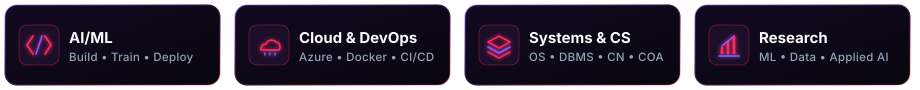
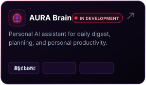
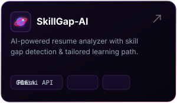
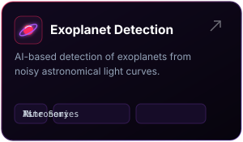
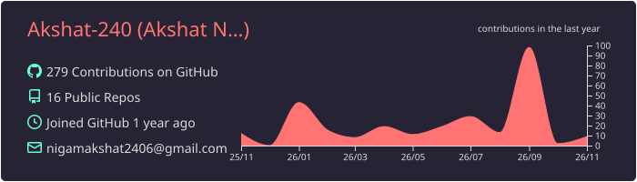

<!-- ================================================================= -->
<!-- CRIMSON ECLIPSE × SUBTLE NEURAL INTERFACE PORTFOLIO README -->
<!-- ================================================================= -->

  <!-- 1. CINEMATIC BANNER WITH INTRODUCTION -->
  

    

  <!-- 2. SOCIAL LINKS ROW -->
  

    
    &nbsp;
    
    &nbsp;
    
    &nbsp;
    
  

 

<!-- 3. ABOUT ME -->
### / About Me

I am a second-year **B.Tech Computer Science and Engineering student (Specializing in AI &amp; ML)** passionate about architecting intelligent systems, cloud-native infrastructures, and solving real-world challenges through rigorous computer science engineering and experimentation.

 

<!-- 4. TECHNICAL FOCUS AREAS -->

  

 

<!-- 5. TECHNOLOGY STACK -->
### / Tech Stack

  

 

<!-- 6. FEATURED PROJECTS -->
### / Featured Projects

  
  &nbsp;
  
  &nbsp;
  

 

<!-- 7. GITHUB STATISTICS -->
### / GitHub Statistics

  
  &nbsp;
  

 

<!-- 8. MOST-USED PROGRAMMING LANGUAGES -->
### / Most Used Languages

  

 

<!-- 9. CONTRIBUTION ACTIVITY GRAPH -->
### / Contribution Activity

  <picture>
    <source media="(prefers-color-scheme: dark)" srcset="https://raw.githubusercontent.com/Akshat-240/Akshat-240/output/github-contribution-grid-snake-dark.svg">
    <source media="(prefers-color-scheme: light)" srcset="https://raw.githubusercontent.com/Akshat-240/Akshat-240/output/github-contribution-grid-snake.svg">
    
  </picture>

 

  

 

  Designed with the <b>Crimson Eclipse × Subtle Neural Interface</b> aesthetic • Built for <b>Akshat-240</b>

